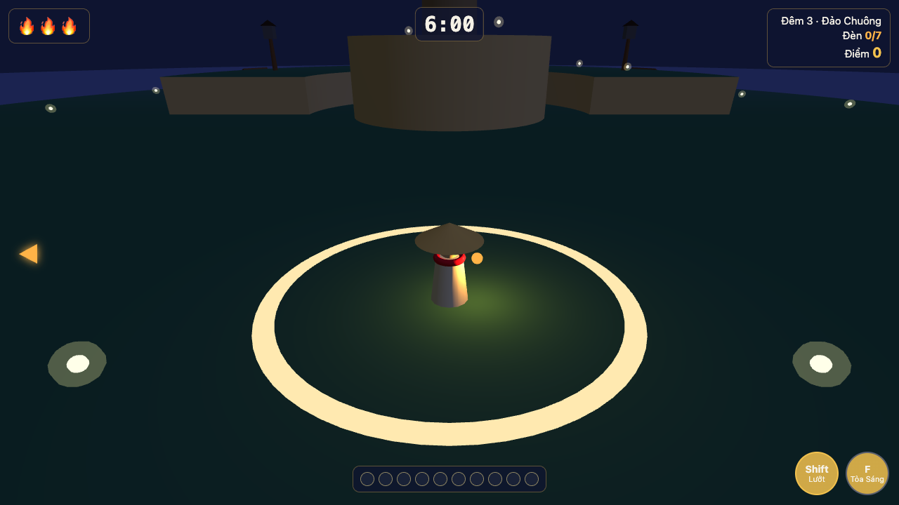
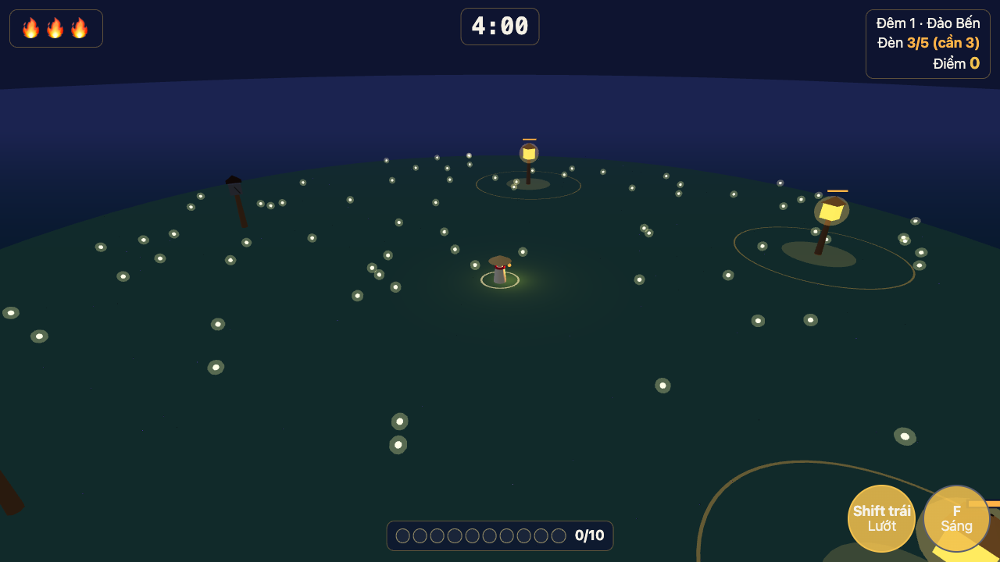

# Đảo Đèn Lồng · v1.0.0

> **Video demo:** đính kèm ở [Release v1.0.0](https://github.com/nghongsan/K5-L3A-DAY12-NguyenThiHongSan-2A202603513-AI-SDLC-Dao-Den-Long/releases/tag/v1.0.0) (`demo.mp4`).
> **Bản chạy được:** `dao-den-long-v1.0.0.zip` trong cùng Release.
> Bài cá nhân Day 12 AI SDLC: Nguyen Thi Hong San (2A202603513). Đề bài: [docs/lab/](docs/lab/README.md)

Game 3D góc nhìn thứ ba. Bạn vào vai **Mây**, người giữ đèn nhỏ tuổi đội nón lá treo đèn lồng. Mây gom đom đóm để thắp và **giữ** các Đèn Lồng Lớn sáng tới bình minh trên ba hòn đảo: Đảo Bến, Đảo Cau và Đảo Chuông. Trong lúc đó Mây phải né **Bóng Mực** chuyên hút dầu đèn và **Gió Lạc** chuyên cướp đom đóm.




## Yêu cầu hệ thống
- **Node.js ≥ 20** (đã thử với 22.23). Không cần cài thêm thư viện nào ngoài `three` (npm tự cài).
- Trình duyệt có **WebGL**: Chrome, Edge, Firefox hoặc Safari. Bench cần **Chrome, Chromium hoặc Edge**.
- macOS hoặc Linux; Windows cũng chạy được. Màn hình từ 1280×720.

## Cài đặt và chạy (3 lệnh)

```bash
git clone https://github.com/nghongsan/K5-L3A-DAY12-NguyenThiHongSan-2A202603513-AI-SDLC-Dao-Den-Long.git && cd K5-L3A-DAY12-NguyenThiHongSan-2A202603513-AI-SDLC-Dao-Den-Long
npm install
npm start          # = node server.mjs: tự mở trình duyệt tại http://localhost:5173 (thêm --no-open để tắt)
```

Bản Release không cần `npm install`: giải nén zip, chạy `node server.mjs`, rồi mở http://localhost:5173.

## Điều khiển (đổi được trong Cài đặt)

| Phím mặc định | Hành động |
|---|---|
| `W A S D` | Di chuyển theo hướng camera |
| `← →` / kéo chuột | Xoay camera |
| `Space` | Nhảy |
| `Shift` | Lướt (14 m/s trong 0.2 s, hồi chiêu 1.5 s) |
| `E` | Nạp ánh sáng vào đèn tắt / châm dầu cho đèn đang sáng |
| `F` | Tỏa Sáng: tốn 3 đom đóm, choáng và đẩy lùi Bóng Mực trong 5 m |
| `Esc` | Tạm dừng: Tiếp tục / Chơi lại Đêm / Cài đặt / Về menu |
| `B` | Bot chơi thử · `F3`: hiện FPS |

## Luật chơi

- **Mục tiêu:** còn sống tới bình minh với ít nhất 60% số đèn đang sáng. Đêm 1 cần 3/5, Đêm 2 cần 4/6, Đêm 3 cần 5/7.
- **Thắp và châm dầu:** đèn chưa từng sáng cần 10 đom đóm, đèn từng sáng chỉ cần 5. Đèn hao 1 dầu/giây và tắt khi hết dầu. Mỗi đom đóm châm thêm 10 dầu.
- **Đèn yếu:** dưới 30 dầu thì đèn nhấp nháy và mất vùng an toàn 6 m. Bóng Mực tới hút 5 dầu/giây.
- **Sức chứa** = 10 + 2 × số lần thắp thành công, tối đa 20.
- **Bị đánh và rơi:**
  - Có 3 Ngọn Lửa.
  - Bị Bóng Mực chạm: mất 1 lửa và rơi một nửa số đom đóm.
  - Rơi khỏi đảo: mất 1 lửa và toàn bộ đom đóm.
- **Gió Lạc** cướp 3 đom đóm khi Mây mang từ 5 con trở lên. **Bùa Gió** cho chạy nhanh và lướt không hồi chiêu.
- **Điểm:**
  - +5 mỗi đom đóm nạp hoặc châm.
  - +100 thắp lần đầu, +40 thắp lại.
  - +5 mỗi Bóng Mực trúng Tỏa Sáng (+15 nếu nó đang hút dầu).
  - Khi thắng: mỗi đèn sáng +50 + floor(dầu), mỗi lửa +50.
  - Tổng điểm = tổng các Đêm đã thắng.
- **Bảng xếp hạng** (top 10) mở từ menu. Bạn nhập tên sau màn Bình Minh hoặc sau khi thua. Tên dài 3–12 ký tự, dùng được tiếng Việt có dấu.

Số liệu nằm trong [game.contract.json](game.contract.json). Quyết định thiết kế ở [docs/adr/](docs/adr/0001-lantern-fuel-and-dawn-win.md); lịch sử thay đổi ở [CHANGELOG.md](CHANGELOG.md).

## Dễ tiếp cận
- **Đổi phím** cho mọi hành động. Game báo khi bạn chọn phím trùng, có nút **Khôi phục mặc định**, và lưu lại lựa chọn.
- **Phụ đề và chỉ báo hình ảnh** khi Bóng Mực xuất hiện (kèm mũi tên ở mép màn hình), gió sắp thổi, 10 giây cuối, và đèn còn dưới 30 dầu.
- **Giảm chuyển động:** tắt rung camera, chớp màn hình và việc camera tự xoay ở menu.
- **Chữ UI:** tối thiểu 18 px ở 1280×720, có tùy chọn **Chữ lớn ×1.25**.
- **Bảng màu dễ phân biệt:** Bóng Mực màu #00B3FF, cảnh báo màu trắng kèm ⚠. Đèn tắt bị xẹp và có vết rách nên phân biệt được mà không cần màu.

## Test, headless, bench, soak

```bash
npm test                                                        # 66 test (node:test): luật 4 phase, CLI, bảng xếp hạng, soak, bench mode
node src/headless/cli.js --seed 1 --night 1 --ticks 600 --out out/run.jsonl [--scenario s.json] [--inputs i.json] [--snapshot-every 10]
node scripts/bench.mjs --seed 42 --duration 30 --out bench.json # mở cửa sổ Chrome 1280×720 (thêm --headless nếu không có màn hình)
node --expose-gc --jitless scripts/soak.mjs --seed 7 --nights 10 --out soak.json
node server.mjs --export-leaderboard out.json                   # xuất bảng xếp hạng {"entries": [...]}
node scripts/ui-smoke.mjs                                       # kiểm thử giao diện thật qua Chrome: menu, tạm dừng, đổi phím, cỡ chữ, lưu điểm
npm run proof -- --phase 4 --no-fps                              # chạy mọi kiểm chứng (kể cả ui-smoke), ghi vào docs/proof/phase-4/
```

- **Headless** theo Test Contract **v1.3**. Mã thoát: 0 xong; 2 file inputs/scenario sai định dạng; 1 lỗi khác.
- **Bench:** chạy cảnh chuẩn của Ticket-04 trong Chrome. Trên Linux không có màn hình (không có `DISPLAY`/`WAYLAND_DISPLAY`), bench tự chuyển sang headless.
  - **Vsync và trần khung hình đã tắt** bằng `--disable-gpu-vsync --disable-frame-rate-limit`.
  - `peak_mem_mb` là tổng RSS của cả cây tiến trình Chrome.
  - Kết quả của tôi nằm ở [bench.json](bench.json): 294.8 FPS trung bình, p1-low 93.5, tải 3.3 s (Apple M1).
- **Soak:** 10 Đêm trong một tiến trình. Chạy với `--jitless` vì JIT của V8 cấp thêm khoảng 20 MB bộ nhớ mã một lần; heap của game không tăng (xem [docs/notes/phase-4.md](docs/notes/phase-4.md)). Kết quả ở [soak.json](soak.json).
- **CI:** GitHub Actions chạy `npm test` và một lần headless kiểm tra tất định ở mỗi lần push.

## Bằng chứng và ghi chép
- Truy vết yêu cầu → bằng chứng: [Phase 1](docs/proof/phase-1/README.md) · [Phase 2](docs/proof/phase-2/README.md) · [Phase 3](docs/proof/phase-3/README.md) · [Phase 4](docs/proof/phase-4/README.md)
- Spec, giả định và đánh giá từng phase: [docs/notes/](docs/notes/) · Retro: [docs/notes/retro.md](docs/notes/retro.md) · Nhật ký AI và token: [docs/notes/ai-log.md](docs/notes/ai-log.md)

## Cấu trúc

```text
game.contract.json      Test Contract v1.3 (+ bench_cmd, soak_cmd) + tuning (nguồn số liệu duy nhất)
src/core/               lõi tất định: sim.js (luật), maps.js (3 bản đồ), io.js, runner.js, bot.js
src/headless/cli.js     CLI headless
web/                    giao diện Three.js + audio.js (WebAudio)
server.mjs              server tĩnh + API bảng xếp hạng (~/.dao-den-long/leaderboard.json) + --export-leaderboard
scripts/                bench.mjs, soak.mjs, proof.mjs, bench-fps.mjs, build-release.mjs, token-usage.mjs
tests/                  node:test (sim, phase2, phase3, phase4, cli)
docs/                   adr/, notes/, proof/phase-N/, lab/ (đề bài), demo/ (kịch bản video)
```

## Harness AI
- [AGENTS.md](AGENTS.md) (+ [CLAUDE.md](CLAUDE.md)): lệnh, bố cục, quy tắc; được cập nhật qua 4 phase.
- [.claude/settings.json](.claude/settings.json): hook `Stop` chạy `npm test` và không cho agent kết thúc khi test đỏ.
- [.claude/skills/verify-phase](.claude/skills/verify-phase/SKILL.md): quy trình kiểm chứng, lưu bằng chứng và gắn tag.

## Sáng tạo của tôi
Các phần thêm chỉ nằm ở giao diện; đầu ra headless và cảnh bench không đổi (bằng chứng: `npm test` xanh, tất định 3 Đêm trong [proof-summary](docs/proof/phase-4/proof-summary.md)).
- **Ông Đăng** dẫn chuyện ở màn giới thiệu từng Đêm và màn Bình Minh.
- **Bot chơi thử** (`B`): chỉ dùng input như người chơi, biết châm dầu, qua cầu và lên dốc. Dùng để xem demo và cân chỉnh độ khó.
- **Vòng an toàn phát sáng** quanh đèn, **lá bay** báo gió, **âm thanh tự tổng hợp** (không dùng file ngoài).

## Giấy phép
MIT: [LICENSE](LICENSE). Nguồn tài nguyên và công cụ AI: [CREDITS.md](CREDITS.md).
